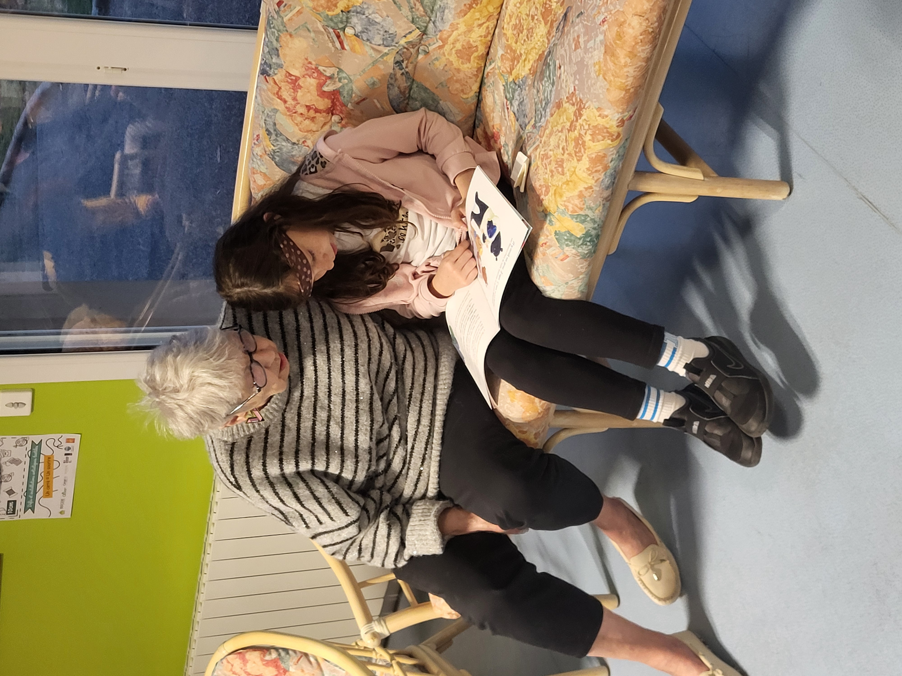
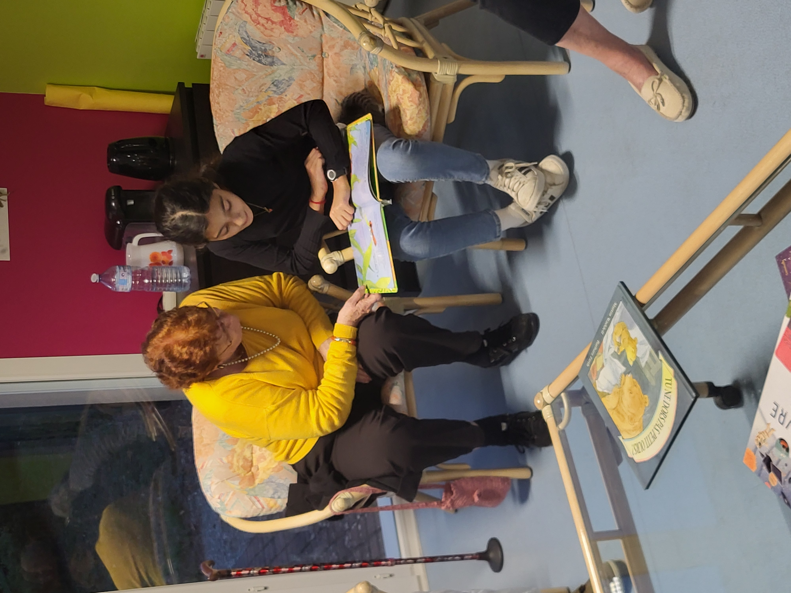
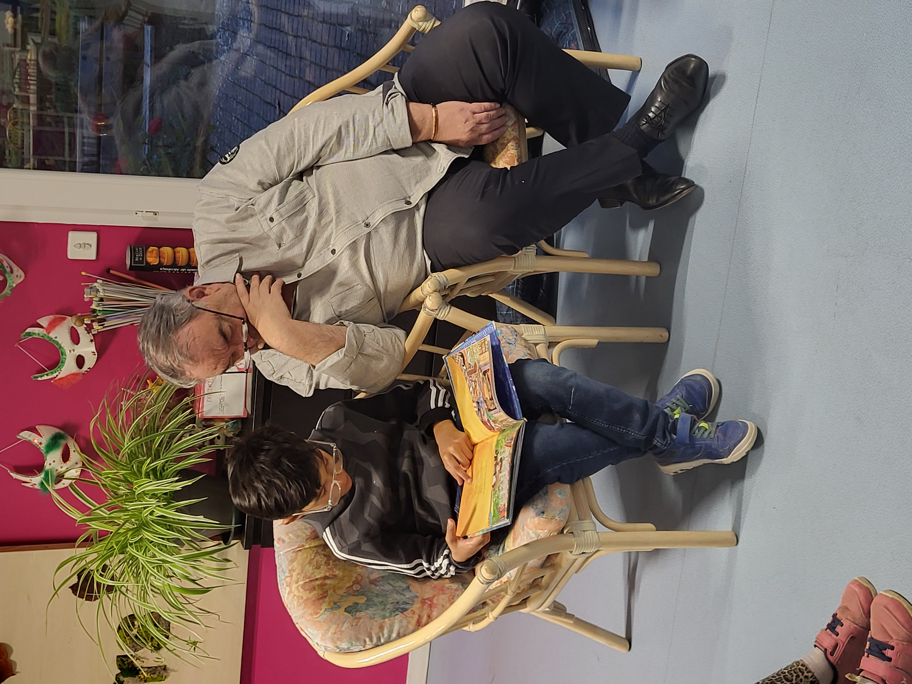
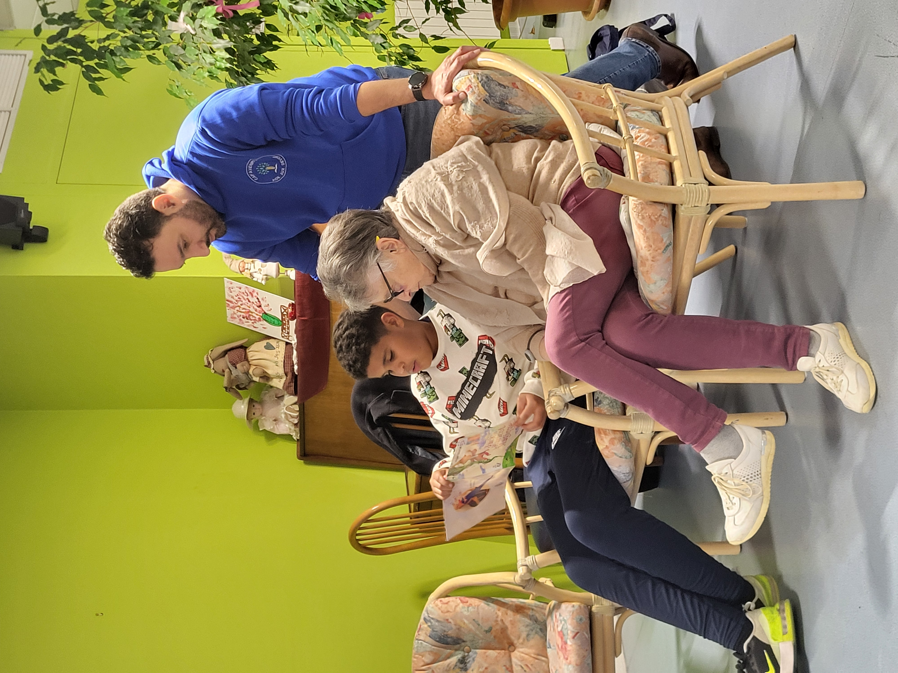
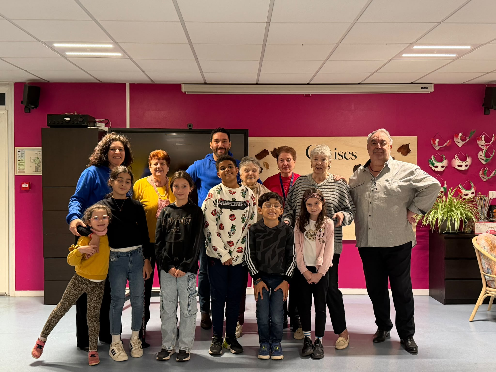
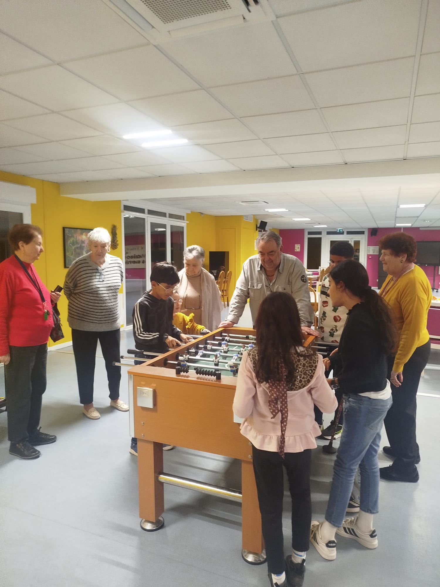

++**Des livres, des sourires et des générations qui se rencontrent aux Cytises**++

Il y a des moments simples qui créent de très beaux souvenirs. C'est dans cet esprit que l'association Cap'Avenir78 a organisé un atelier lecture à la résidence Les Cytises, le 9 novembre 2026, réunissant ses jeunes adhérents et les résidents autour d'un moment de partage et de convivialité. 

À travers les mots, les histoires et les échanges, petits et grands ont pu se retrouver, apprendre à se connaître et partager un moment privilégié. Pour les enfants, c'était l'occasion de découvrir le plaisir de lire autrement, mais aussi de prendre le temps d'écouter, d'échanger et de créer du lien avec leurs aînés.

Au-delà de la lecture, cette rencontre porte une belle ambition : favoriser les échanges entre générations, lutter contre l'isolement et transmettre le goût du partage.

Parce que l'éducation ne se limite pas aux apprentissages scolaires, Cap'Avenir78 tient à proposer aux jeunes des expériences qui leur permettent de grandir, de s'ouvrir aux autres et de devenir des citoyens attentifs et engagés.

Nous remercions chaleureusement l'équipe de la résidence Les Cytises pour son accueil et sa collaboration, ainsi que les résidents et les enfants qui ont contribué à la réussite de ce beau moment.

